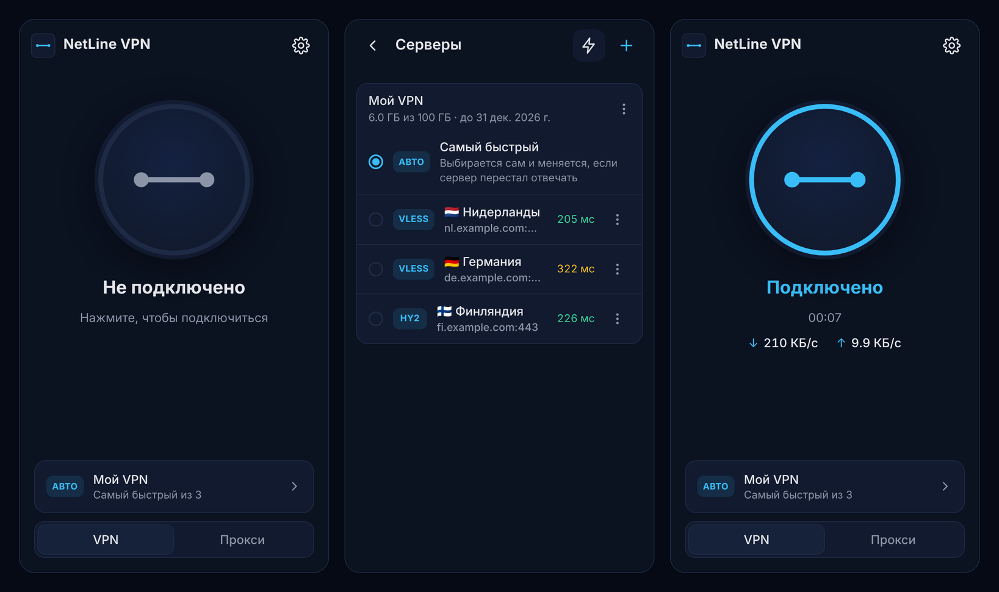

# NetLine VPN

Простой и быстрый клиент VPN и прокси для Windows, macOS, Linux и Android.
Вставьте ссылку или подписку, нажмите одну кнопку — и весь трафик устройства идёт через ваш сервер.
Без аккаунтов, без рекламы и телеметрии.

**[Скачать последнюю версию →](https://github.com/uproxe/NetLineVPN/releases/latest)** · [История изменений](CHANGELOG.md)

## Что умеет

- **Одна кнопка.** Главный экран — кнопка подключения, скорость и выбранный сервер. Настроек ровно четыре.
- **VPN для всего устройства** или **системный прокси** (на компьютере — переключатель «VPN / Прокси»).
- **Все современные протоколы** — см. таблицу ниже. Обычные VPN тоже: WireGuard, OpenVPN, OpenConnect.
- **Подписки** с объёмом трафика и сроком действия, обновляются сами раз в 12 часов.
- **«Самый быстрый»** сервер подписки выбирается сам и меняется, если перестал отвечать.
- **Проверка задержки** настоящим подключением через каждый сервер, а не просто ping.
- **Российские сайты напрямую** — банки, Госуслуги и сайты в зоне .ru открываются без VPN.
- **Лёгкий.** Окно на системном движке (без Electron), ядро запускается только при подключении.
  Если закрыть окно при включённом VPN, программа остаётся в области уведомлений и почти не занимает память.
- **Без утечек.** DNS идёт через сервер по защищённому каналу (DoH); на Android локальный вход ядра закрыт паролем.

### Протоколы

| Что | Поддержка |
|---|---|
| VLESS | Reality, XTLS Vision, TLS, WebSocket, gRPC, HTTPUpgrade, **XHTTP**, mKCP, VLESS Encryption (ML-KEM) |
| VMess, Trojan | TCP, WebSocket, gRPC, HTTPUpgrade, HTTP/2, QUIC, TLS |
| Shadowsocks | AEAD, Shadowsocks 2022, плагины obfs и v2ray-plugin, UDP over TCP |
| Hysteria2, Hysteria | Salamander, смена портов (port hopping) |
| TUIC v5, AnyTLS, NaiveProxy, SSH | |
| WireGuard | ссылка `wireguard://` или файл `.conf` |
| OpenVPN | файл `.ovpn` со встроенными сертификатами, логин и пароль |
| OpenConnect | Cisco AnyConnect / ocserv, Fortinet, GlobalProtect, Pulse, F5, Juniper |
| Прокси | SOCKS5, HTTP, HTTPS — ссылкой или вручную |
| Подписки | список ссылок, base64, JSON Xray (с фрагментацией) и sing-box, заголовки `subscription-userinfo` и `profile-title` |

AmneziaWG и формат Clash (YAML) пока не поддерживаются.

## Установка

| Система | Файл | Как поставить |
|---|---|---|
| Windows 10 и 11 | `NetLineVPN-…-windows-x64-setup.exe` | Запустите установщик. Если появится «Система Windows защитила ваш компьютер» — «Подробнее» → «Выполнить в любом случае». |
| macOS 10.15 и новее (M1–M4 и Intel) | `NetLineVPN-…-macos-universal.dmg` | Перетащите NetLine VPN в «Программы». При первом запуске: «Системные настройки» → «Конфиденциальность и безопасность» → «Всё равно открыть». |
| Ubuntu, Debian, Mint, Astra | `netline-vpn_…_amd64.deb` | `sudo apt install ./netline-vpn_*_amd64.deb` |
| Fedora, РЕД ОС, РОСА | `netline-vpn-…x86_64.rpm` | `sudo dnf install ./netline-vpn-*.x86_64.rpm` |
| openSUSE | `netline-vpn-…x86_64.rpm` | `sudo zypper install --allow-unsigned-rpm ./netline-vpn-*.x86_64.rpm` |
| Arch, Manjaro | `netline-vpn-…-x86_64.pkg.tar.zst` | `sudo pacman -U ./netline-vpn-*-x86_64.pkg.tar.zst` |
| Любой другой Linux | `NetLineVPN-…-x86_64.AppImage` | `chmod +x NetLineVPN-*.AppImage` и запустить. |
| Android 8 и новее | `NetLineVPN-…-android-arm64.apk` | Откройте файл на телефоне и разрешите установку из этого источника. |

Предупреждения Windows и macOS появляются потому, что у программы нет платной подписи Microsoft и Apple.

## Как пользоваться

1. Нажмите на карточку сервера внизу → **+**.
2. Вставьте ссылку (`vless://…`, `hysteria2://…`), адрес подписки или содержимое файла WireGuard/OpenVPN.
   Можно просто нажать Ctrl+V на главном экране или «Поделиться» ссылкой на телефоне.
3. Нажмите большую кнопку.

## Частые вопросы

**Почему Windows спрашивает разрешение администратора?** Без прав администратора Windows не даёт создать
VPN-подключение. При автозапуске («Настройки» → «Запускать вместе с системой») окно не появляется.

**macOS просит пароль при подключении.** Так macOS разрешает программам без платной подписи Apple
включать VPN для всего компьютера. Режим «Прокси» пароль не спрашивает.

**Linux.** В пакетах .deb, .rpm и для Arch ядру при установке выдаётся только право настраивать сеть
(`cap_net_admin`) — пароль при подключении не нужен. AppImage спрашивает пароль через `pkexec`.

**Какой порт у прокси?** `127.0.0.1:10808` (SOCKS5 и HTTP на одном порту) — его можно указать в других программах.

**Как сделать, чтобы VPN включался сам?** Компьютер: «Запускать вместе с системой» и «Подключаться при запуске».
Android: «Подключаться при запуске», плитка в быстрых настройках или «Постоянная VPN» в настройках Android.

**Что делать, если не подключается?** «Настройки» → «Журнал подключения» покажет причину.
Если сервер заблокирован, попробуйте другой протокол — например, XHTTP или Hysteria2.

**Где хранятся данные?** Только на устройстве: Windows — `%APPDATA%\io.github.uproxe.netline`,
macOS — `~/Library/Application Support/io.github.uproxe.netline`, Linux — `~/.config/io.github.uproxe.netline`.

---

<b>Для разработчика</b>

### Как устроено

| Часть | Папка | Что это |
|---|---|---|
| Интерфейс и логика | `ui/` | Страница на чистом JavaScript: разбор ссылок и подписок (`lib/links.js`), сборка конфигураций ядер (`lib/config.js`). Одна и та же на компьютере и Android |
| Компьютер | `desktop/` | Tauri 2 (Rust): окно на системном движке, трей, автозапуск, запуск ядер, права на VPN |
| Android | `android/` | Java: WebView с тем же интерфейсом, `VpnService` + hev-socks5-tunnel, плитка быстрых настроек |
| Ядра | `cores.env` | sing-box — VPN (TUN), DNS, правила и большинство протоколов; Xray — XHTTP, mKCP, VLESS Encryption и конфигурации Xray из подписок |
| Значки | `branding/` | SVG; `tools/make_icons.py` делает PNG, ICO, ICNS и значки Android |

Схема: `приложения → TUN (sing-box) → правила → сервер` или, для возможностей Xray,
`sing-box → локальный SOCKS5 с паролем → Xray → сервер`. На Android: `VpnService → hev-socks5-tunnel → sing-box`.

### Проверки

* `node tests/test.js` — разбор ссылок, подписок, файлов и сборка конфигураций.
* `bash tests/check-configs.sh` — все варианты конфигураций проверяются настоящими `sing-box check` и `xray -test`.
* В CI установщик Windows ставится в тихом режиме, пакет .deb — на чистую систему с проверкой прав ядра.

Сборка — в [docs/BUILD.md](docs/BUILD.md). Новая версия: поменять `VERSION`, `desktop/Cargo.toml`
и `CHANGELOG.md` и отправить в `main` — релиз соберётся сам.

## Лицензия

MIT. В установщики входят отдельные программы со своими лицензиями: sing-box (GPL-3.0),
Xray-core (MPL-2.0), hev-socks5-tunnel (MIT).
